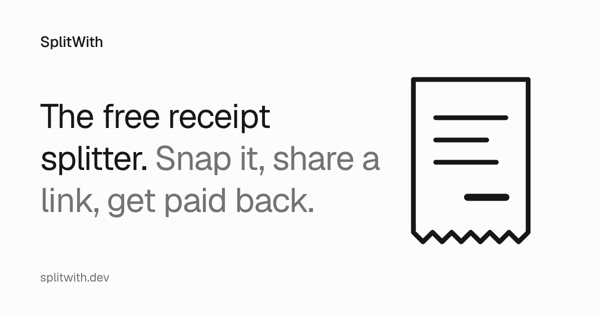

# SplitWith

[](https://splitwith.dev)

**The free receipt splitter.** Take a photo of the receipt, share one link, and everyone taps what they had and pays you back. No app, no sign-up, no ads.

Live at **[splitwith.dev](https://splitwith.dev)**.

## How it works

1. **Snap the receipt.** Take a photo or pick a screenshot of an online order. SplitWith reads every item and price.
2. **Share one link.** Friends open it in any browser and tap what they had. Claims show up live for everyone.
3. **Get paid back.** Tax, tip and discounts split in proportion to what each person had. Each friend pays you on Venmo, Cash App, PayPal or Zelle in one tap.

Every scan runs a total check: the items must add up to the subtotal, and the subtotal plus tax, tip and fees must match the total. When something doesn't add up, the rows that need a look are marked, and anyone can tap a row to fix it.

## What makes it different

- **Friends claim their own items.** The person who paid doesn't have to sort out who had what.
- **Nothing to install.** It's a website, and nobody needs an account.
- **No limits.** No daily cap on splits and no paywall on itemized receipts.
- **Equal access.** Everyone with the link can claim, edit or fix rows, and History lists every change and can undo most of them. Only the person who paid can change where the money goes.
- **Private by default.** The receipt photo is shrunk, stored only with its split, and deleted after 14 days.
- **Any currency.** Tap the total to change it.

## How it's built

| Part | What it does |
|---|---|
| App | One [Expo](https://expo.dev) Router app in React Native, exported as a static website (`app/`, `src/ui/`) |
| Reading | The phone runs PaddleOCR with onnxruntime-web in a Web Worker (`src/ocr/`). The server then reads the photo and those lines with Gemini through OpenRouter (`worker/scan/`). If that fails or runs slow, a rule-based parser on the phone takes over (`src/parse/`). |
| Money | Integer minor units, leftover cents handed out in a fixed order so every device gets the same shares (`src/core/`) |
| Live claiming | One Cloudflare Durable Object per split, over WebSockets with `partyserver` (`worker/split-server.ts`, `src/live/`) |
| Hosting | A Cloudflare Worker serves the static site and the API (`worker/index.ts`, `wrangler.jsonc`) |
| Cost control | Signed split ids, per-address rate limits, and a $3 daily cap on scans |

Reading a receipt costs about a tenth of a cent, and the rest runs on Cloudflare's free or $5 plan, so the site can stay free.

## Run it locally

You need Node 22.

```sh
npm ci
cp .dev.vars.example .dev.vars   # then fill in the values
npm run build                    # export the site to dist/
npm run serve                    # wrangler dev: the site plus the API and live claiming
```

`.dev.vars` holds two settings:

- `SPLIT_ID_SECRET` signs split ids. Any 32 or more characters work locally, for example the output of `openssl rand -base64 32`. Without it, creating a split fails.
- `OPENROUTER_API_KEY` lets the server read receipts. Without it, scans use the on-device reader.

`npm run dev` starts the Expo dev server for UI work, without the Worker behind it.

## Checks

| Command | What it runs |
|---|---|
| `npm test` | Unit tests (Vitest) |
| `npm run test:worker` | Worker tests in the Workers runtime |
| `npm run lint` | ESLint |
| `npm run typecheck` | TypeScript for the app and the Worker |
| `npm run e2e` | Playwright end-to-end tests against a local `wrangler dev` |
| `npm run size` | Bundle size budgets |
| `npm run bench` | Scores receipt reading against labeled receipts |

CI runs these on every pull request. Every push to `main` that passes CI deploys to production, as [docs/deploy.md](docs/deploy.md) describes.

## Repo map

```
app/        Routes: home, the split page (/s/<id>), How it works
src/core/   Money, shares, the total check, payment links
src/ocr/    On-device OCR
src/parse/  Rule-based receipt parser, the fallback reader
src/live/   Live sync client
src/ui/     Screens and components
worker/     Cloudflare Worker: API, scans, one Durable Object per split
e2e/        Playwright tests
bench/      Receipt reading benchmark
docs/       Deploy guide, decisions (adr/), plans, design notes
```

## Further reading

- [description.md](description.md): the product brief, positioning and costs
- [CONTEXT.md](CONTEXT.md): the words the code and docs use (Split, Item, Claim, Adjustment and so on)
- [docs/adr/](docs/adr/): why it's built this way, one decision per file
- [docs/deploy.md](docs/deploy.md): Cloudflare setup and deploys
